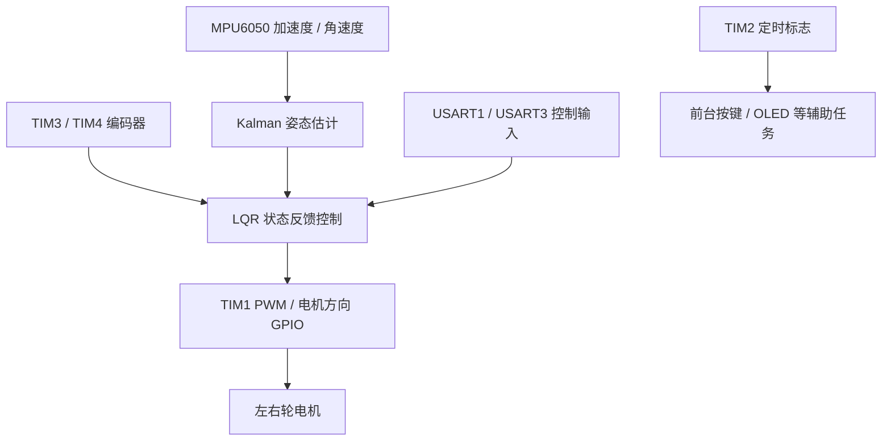

# STM32 两轮自平衡小车 | Self-Balancing Robot

> 一份围绕 STM32F103 两轮平衡车整理的嵌入式工程学习仓库。包含原有的硬件固件、控制架构说明，以及**独立的 PID 学习示例**。

**实际项目背景：** 已完成两轮自平衡小车实物调试并实现基本平衡（由项目实践者提供）。本仓库所附固件版本的平衡控制器是 **LQR**，使用**定时器标志调度 + 传感器中断**，而**不是 FreeRTOS + PID**。因此此代码包不作为 FreeRTOS 或 PID 固件已部署的证明。

## 功能与技术栈

| 类别 | 当前工程内容 |
| --- | --- |
| 主控 | STM32F103C8Tx（原工程面向 WHEELTEC B570 参考小车） |
| 语言 | C / C++17 |
| 工具 | STM32CubeMX 配置文件、STM32 HAL、CMake、ARM GCC |
| 姿态 | MPU6050（软件 I2C）、Kalman 俯仰角估计 |
| 运动反馈 | TIM3 / TIM4 编码器测速 |
| 平衡控制 | 六状态 LQR，TIM1 PWM + GPIO 电机方向控制 |
| 控制触发 | MPU6050 PA12 外部中断；参数设置的控制周期为 5 ms |
| 辅助任务 | TIM2 产生 5 ms 标志，前台循环处理按键、OLED 等 |
| 其他模块 | 蓝牙 / 串口遥控、超声波模式、OLED、电池检测代码 |
| 独立学习示例 | `examples/pid_basics/`：标准 C++ PID 控制器 + 计算机端单元测试 |

**提醒：** 固件内的部分功能可能需要实际连线、标定和参数调整；例如 `car_config.hpp` 中默认关闭了电池监测和电池低压保护。不能仅凭代码推断所有扩展功能都已完成实物验证。

## 我学习／实践了什么

- 两轮平衡车的姿态反馈、编码器测速和电机驱动流程。
- 理解闭环控制的基本框架：**传感器读取 → 姿态估计 → 控制器计算 → PWM 输出**。
- 在现有工程中学习 **LQR**，并额外整理 **PID** 的基础示例，区分二者的算法与代码实现。
- 学习 C/C++ 代码组织、STM32 外设初始化及嵌入式项目的调试过程。

> 发布作品时请根据自己**实际完成的工作**调整上述表述。原工程和其中第三方代码的来源/许可见 [`THIRD_PARTY_NOTICES.md`](THIRD_PARTY_NOTICES.md)。

## 主要目录

```text
STM32-Self-Balancing-Car/
├── Core/
│   ├── CODE/                    平衡车业务模块（LQR、Kalman、电机、编码器等）
│   ├── Inc/                     STM32 头文件
│   ├── Src/                     主程序及外设初始化
│   └── Startup/                 STM32 启动文件
├── Drivers/                     STM32 HAL、CMSIS（保留原许可证）
├── examples/pid_basics/         独立 PID 学习代码（非车端固件）
├── docs/
│   ├── architecture.md          控制架构
│   ├── hardware-and-safety.md   硬件及安全提示
│   ├── project-introduction.md  黑客松申请内容模板
│   ├── pid-and-freertos.md      PID / FreeRTOS 状态说明
│   └── github-upload.md         GitHub 上传指南
├── images/                      放入自己的实物照片、调试截图
├── BalancingCar.ioc             CubeMX 外设配置
├── CMakeLists.txt                原固件 CMake 构建入口
└── STM32F103C8TX_FLASH.ld      链接脚本
```

## 控制流程



主平衡控制在 MPU6050 的 EXTI 回调中运行；TIM2 的定时标志主要安排辅助任务。源码详解见 [`docs/architecture.md`](docs/architecture.md)。

## 编译原固件

需要安装 CMake（原工程要求 3.31+）、`arm-none-eabi-gcc/g++` 和构建工具（如 Ninja）。在**仓库根目录**执行：

```bash
cmake -S . -B build/firmware -G Ninja
cmake --build build/firmware
```

输出文件使用原工程目标名 `BalancingCar.elf`、`BalancingCar.hex`、`BalancingCar.bin`。保留旧目标名是为了兼容原工程的构建及 CubeMX/IDE 配置；**GitHub 仓库名称不影响固件运行**。

本次整理环境**没有 ARM 交叉编译器，也没有在实体硬件上烧录验证**；因此不能声称新的压缩包已完整通过固件构建或实物回归测试。烧录前请先核对目标板、引脚、电机方向与参数。

## 运行 PID 学习示例（电脑端）

```bash
cmake -S examples/pid_basics -B build/pid-basics
cmake --build build/pid-basics
ctest --test-dir build/pid-basics --output-on-failure
```

详细解释与运行结果见 [`examples/pid_basics/README.md`](examples/pid_basics/README.md)。**这个例子不连接硬件，不能直接替换 LQR 固件或证明 FreeRTOS 已经移植。**

## 项目展示（请补充真实素材）

将你自己拍摄的平衡车照片、接线图、OLED 界面、运行视频截图放到 [`images/`](images/) 内。然后取消下面示例的注释并按真实文件名调整：

```markdown
<!--  -->
<!-- [查看演示视频](你实际上传的视频地址) -->
```

建议展示：车体站立、短暂扰动后恢复平衡、控制参数或调试界面。不要使用网上的示意图冒充实物成果。

## 申请黑客松与简历

可直接参考 [`docs/project-introduction.md`](docs/project-introduction.md) 的项目介绍。**FreeRTOS / PID 与当前固件不匹配的地方必须按你的真实版本修改，不能只改项目名称。**

## 第三方声明与安全

- 该代码基于上传的已有工程整理，保留 HAL/CMSIS 许可文件；项目可能包含 WHEELTEC 参考实现，**发布前请确认各部分代码的实际来源及再发布许可**。
- 未经确认，不应把他人参考代码全部描述为“独立原创”。
- 平衡车初次上电请架空车轮测试，检查电机方向、倾角和 PWM 限幅，并确保可以快速断电；详细步骤见 [`docs/hardware-and-safety.md`](docs/hardware-and-safety.md)。
